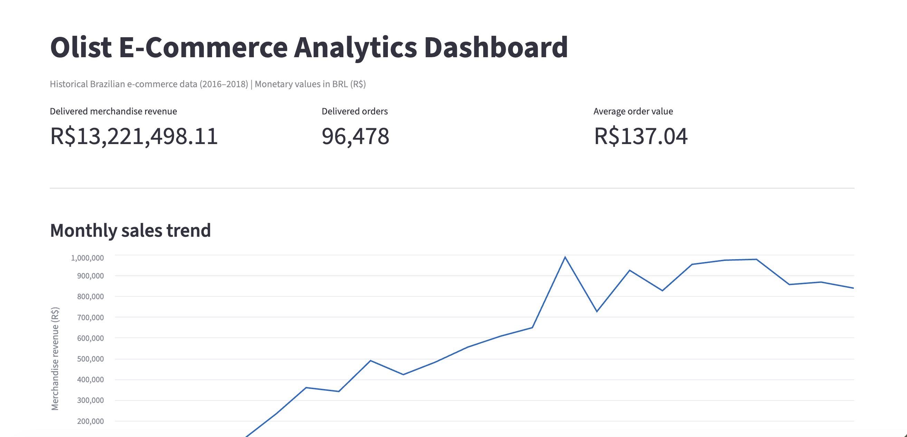
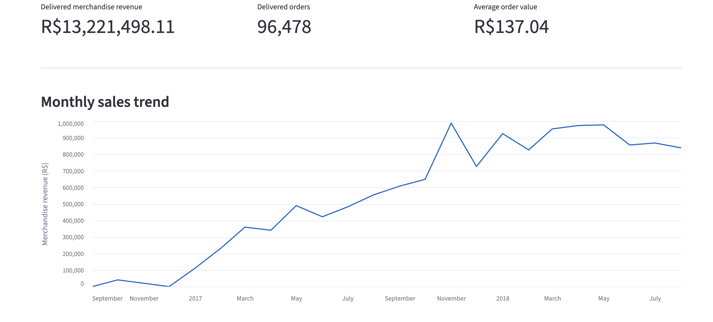
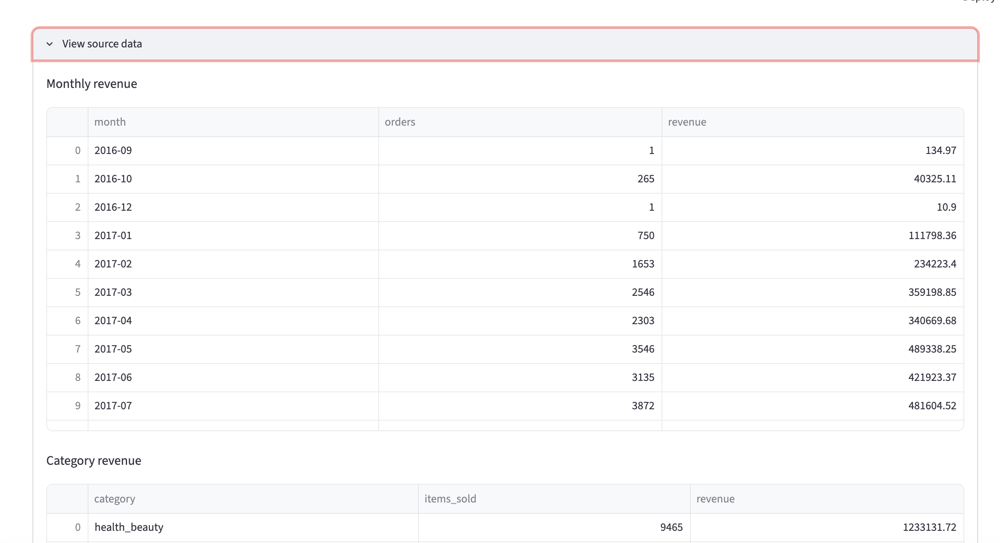
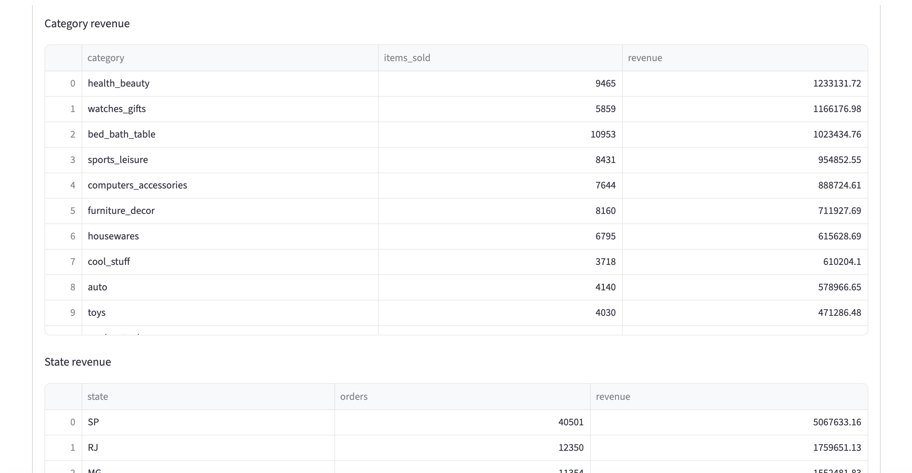
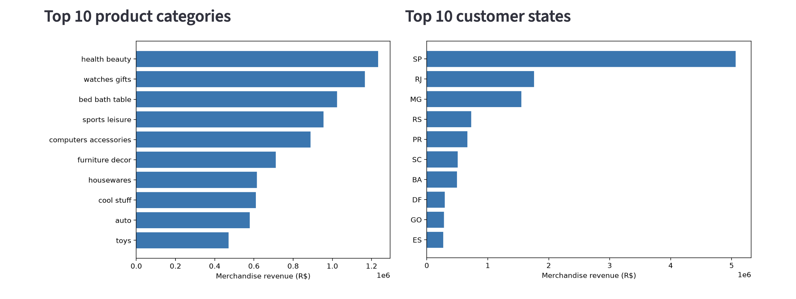
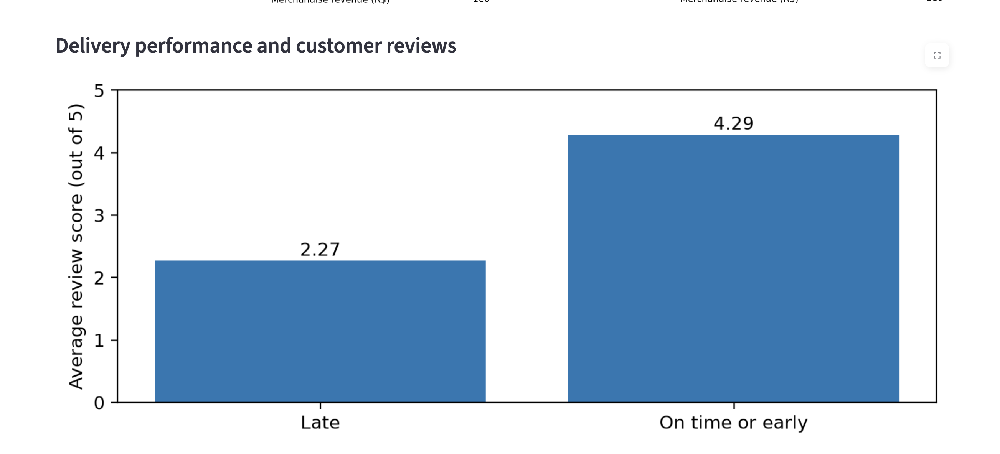

# Olist E-Commerce Sales Analytics

An end-to-end retail analytics portfolio project using **SQL, SQLite, Python, pandas, and Streamlit** to analyze historical Brazilian e-commerce transactions.

The project transforms raw transactional data into business insights covering sales performance, customer behavior, product categories, geographic trends, and delivery satisfaction.

## Project Overview

**Dataset:** Brazilian E-Commerce Public Dataset by Olist  
**Period analyzed:** 2016–2018  
**Database:** SQLite  
**Dashboard:** Streamlit

## Dashboard Preview

The interactive Streamlit dashboard presents key business metrics,
sales trends, product performance, geographic insights, and
customer satisfaction analysis.

### Dashboard Screenshots













### Business Questions

- How much merchandise revenue did delivered orders generate?
- Which product categories and geographic markets perform best?
- What percentage of customers placed repeat orders?
- How long does delivery take, and how frequently are orders late?
- How does delivery performance relate to customer satisfaction?

## Key Findings

| Metric | Result |
|---|---:|
| Delivered orders | 96,478 |
| Delivered merchandise revenue | R$13,221,498.11 |
| Average order value | R$137.04 |
| Repeat customers | 3.12% |
| Average delivery time | 12.56 days |
| Late delivery rate | 6.77% |
| Average review score — on time or early | 4.29/5 |
| Average review score — late | 2.27/5 |

### Business Insights

**1. Geographic concentration**

São Paulo (SP) generated approximately 38.33% of delivered merchandise revenue, making it the largest customer market.

**2. Product performance**

Health & Beauty was the highest-revenue product category, generating approximately R$1.23 million, followed by Watches & Gifts and Bed, Bath & Table.

**3. Customer repeat purchasing**

Approximately 3.12% of unique shoppers placed multiple orders in the dataset. This is a historical repeat-purchase measure, not a cohort retention rate.

**4. Delivery and satisfaction**

Late deliveries received an average review score of 2.27/5 compared with 4.29/5 for on-time or early deliveries. This association suggests that delivery reliability is an important area for operational investigation.

## Technologies Used

- **SQL / SQLite:** Database design, joins, aggregations, CTEs, window functions, and data validation
- **Python:** Database setup and data export automation
- **pandas:** Dashboard data processing
- **Streamlit:** Interactive analytics dashboard
- **Git / GitHub:** Version control and project documentation

## Project Structure

```text
Retail-Sales-Analytics/
├── data/
│   ├── raw/                  # Original Olist CSV files
│   └── processed/            # Dashboard-ready CSV files
├── sql/                      # SQL schema, validation and analysis
├── dashboard/
│   └── app.py                # Streamlit dashboard
├── setup_database.py
├── create_tables.sql
├── export_dashboard_data.py
├── requirements.txt
├── .gitignore
└── README.md
```

## SQL Skills Demonstrated

- `INNER JOIN` and `LEFT JOIN`
- `GROUP BY`, `HAVING`, and aggregate functions
- Common Table Expressions (`WITH`)
- Window functions: `RANK()` and `SUM() OVER()`
- Date analysis with `strftime()` and `julianday()`
- Conditional logic using `CASE`
- Data quality and relationship validation
- Handling one-to-many relationships without double-counting

## Data Validation

The project includes SQL checks to verify database relationships and completeness.

Validated results:

- Orders without matching customers: **0**
- Delivered orders missing delivery dates: **0**

These checks are part of the data quality assessment and do not constitute exhaustive validation of every dataset field.

## Methodology

Merchandise revenue is calculated using the sum of `order_items.price` for delivered orders. Freight charges are excluded.

Average order value is calculated at the order level to avoid double-counting multi-item orders.

Customer repeat purchases are identified using `customer_unique_id`, which links customer records belonging to the same shopper.

Delivery punctuality compares actual delivery dates against estimated delivery dates.

## How to Run the Project

### 1. Clone the repository

```bash
git clone YOUR_REPOSITORY_URL
cd Retail-Sales-Analytics
```

### 2. Create a virtual environment

```bash
python3 -m venv .venv
source .venv/bin/activate
```

On Windows, activate using `.venv\Scripts\activate`.

### 3. Install dependencies

```bash
python -m pip install -r requirements.txt
```

### 4. Generate dashboard data

The processed CSV exports are included in `data/processed/`.

If the SQLite database has been built locally, regenerate them with:

```bash
python export_dashboard_data.py
```

### 5. Launch the dashboard

```bash
python -m streamlit run dashboard/app.py
```

Open the local address displayed by Streamlit, usually `http://localhost:8501`.

## Dataset

Source: [Brazilian E-Commerce Public Dataset by Olist — Kaggle](https://www.kaggle.com/datasets/olistbr/brazilian-ecommerce)

The dataset contains historical marketplace transactions, customers, orders, products, sellers, payments, reviews, and delivery information.

## Limitations

- The dataset is historical and does not represent current marketplace performance.
- Merchandise revenue is not equivalent to profit.
- Repeat-purchase percentage is not a time-based retention metric.
- Delivery performance and review scores are associated, but the analysis does not establish causation.

## Future Improvements

- Cohort-based customer retention analysis
- Product-category filtering in the dashboard
- Additional order and payment reconciliation checks
- Automated SQL testing

## Author

Simran Dhillon  
SQL & Python Data Analytics Project
